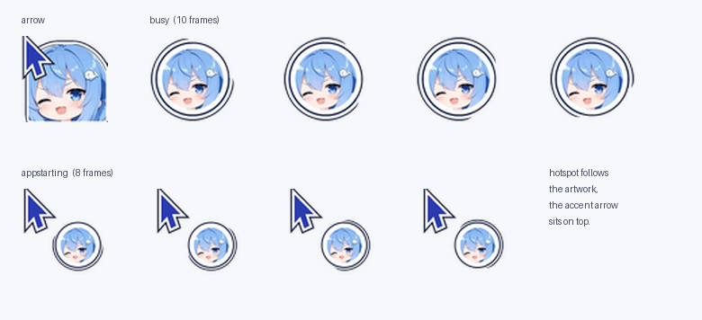

# dsh-cursor-maker

把聊天里发的一张图，变成整套 Windows 鼠标指针，并立刻换上去。

这是一个 [DeepSeek Harness](https://github.com/deepseek-ai) 插件（bundle）。装好之后，你每发一张图片，它都会先问你一句「要不要做成鼠标指针」；你同意，它就当场画出一整套 16 个角色的指针素材，写进注册表，光标立刻变成那个形象。



## 它做了什么

| 角色 | 来源 |
| --- | --- |
| 正常选择 | 图片主体 + 一支压在前面的强调色箭头 |
| 帮助选择 | 同上 + 问号徽章 |
| 忙碌 / 后台运行 | 一圈旋转的强调色光环 + 主体 |
| 后台工作中 | 小箭头 + 主体大徽章 |

其余 12 个角色（文本、十字、移动、缩放、手型、链接、禁用……）沿用包里自带的矢量字形，配色会从图片里采样后统一改写，所以整套看起来是一家的。

- 每个角色都同时生成 32 / 48 / 64 三种尺寸，Windows 按 DPI 自己挑。
- 动画角色（忙碌、后台工作中）是真正的 ANI，10 帧 / 8 帧。
- 拓扑热区跟着图形走：普通指针的点击点在箭头尖上，忙碌指针在圆心。
- 强调色从图片的高饱和像素里取中位色；觉得不对可以用 `accent` 参数手动指定。

## 依赖

- Windows（指针方案是 Windows 的概念，插件只在 win32 上挂载）
- DeepSeek Harness 桌面版
- 一个带 **Pillow** 和 **numpy** 的 Python 3

默认会去找 DSH 运行时自带的那个 Python（`~/.dsh/dsh-runtimes/*/dependencies/python`），找到就用。没有的话，把 `pythonPath` 配成你自己的解释器，或者设置环境变量 `DSH_CURSOR_PYTHON`。

## 安装

```powershell
# 1. 放进 profile 的 node_modules
$profile = "$env:USERPROFILE\.dsh\profiles\desktop"
Copy-Item -Recurse -Force .\dsh-cursor-maker "$profile\node_modules\dsh-cursor-maker"
```

然后在这个 profile 的 `package.json` 里登记两处：

```jsonc
{
  "dsh": {
    "profile": {
      "bundles": [
        // ...
        "dsh-cursor-maker"
      ]
    }
  },
  "dependencies": {
    // ...
    "dsh-cursor-maker": "^0.1.0"
  }
}
```

重启 DSH 即可。插件的默认配置写在它自己的 `cordis.patch.yml` 里，改插件行为请改**你的** profile 里的 `cordis.patch.yml`：

```yaml
- id: dsh-cursor-maker
  name: dsh-cursor-maker
  config:
    enabled: true
    askEachImage: true
    pythonPath: ""
    dataDir: ""
```

## 用法

装好以后，直接发一张图就行。模型会问一句，你说「好」，剩下的它自己做：

```
你：  [图]
AI： 这张要拿去做鼠标指针吗？（会替换你现在用的整套指针）
你：  要
AI：  （调用 cursor_from_image）
      ✓ 生成 16 个角色，已切换到 "DSH Cursor Whalegirl"
```

也可以直接点名要它做：

> 把这张图做成鼠标指针

四个工具：

| 工具 | 作用 |
| --- | --- |
| `cursor_from_image` | 从一张图生成整套指针，默认立即启用。`apply: false` 只生成不切换。 |
| `cursor_apply` | 切回之前生成过的某一套。 |
| `cursor_restore` | 还原成第一次安装之前的指针。 |
| `cursor_status` | 看当前方案、历史素材、Python 是否可用。 |

## 文件放在哪

- 生成的素材：`%LOCALAPPDATA%\DshCursorMaker\sets\<时间戳>-<名字>\`
- 每一套都有 `preview.png`（一眼看全四个角色）和 `meta.json`（记录裁切参数）
- 安装前的原始指针备份：`%LOCALAPPDATA%\DshCursorMaker\backup.json`
- 注册表：`HKCU\Control Panel\Cursors`，方案名以 `DSH Cursor ` 开头

素材只增不删，所以随时能切回去。

## 想改生成效果

整套画图逻辑在 `assets/build_cursors.py`，可以脱离 DSH 单独跑：

```powershell
python assets/build_cursors.py `
  --image path\to\picture.png `
  --out   out\my-set `
  --template assets\template `
  --label "My Set"
```

改完参数再让插件调用，或者先在这里把构图调顺。几处常用的旋钮都在文件顶部：`SIZES`（输出尺寸）、`SS`（超采样倍数）、`ART` 里各角色的几何参数。

## 已知边界

- 只支持 Windows。
- 图片最好是**主体居中、背景干净**的半身图或头像；满屏风景照裁出来的指针会认不出是什么。
- 指针只有 32 像素见方，细节注定会丢。想做「一眼认得出」的指针，选脸大、色块分明的图。
- 还原依赖 `backup.json`；如果那个文件丢了，`cursor_restore` 会退回 Windows Aero。

## 许可

MIT。自带的 12 个矢量字形由本项目绘制。